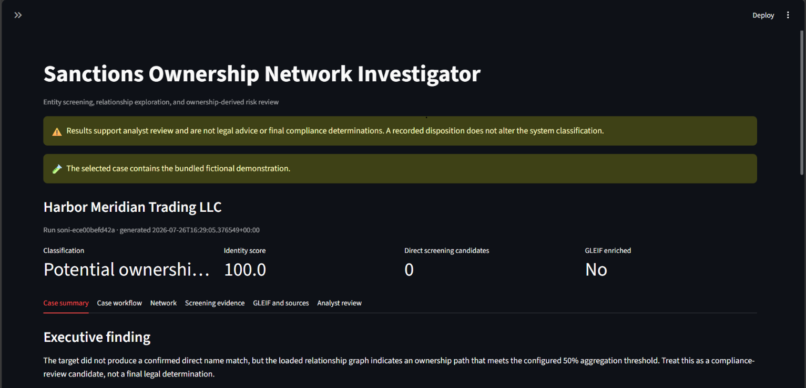
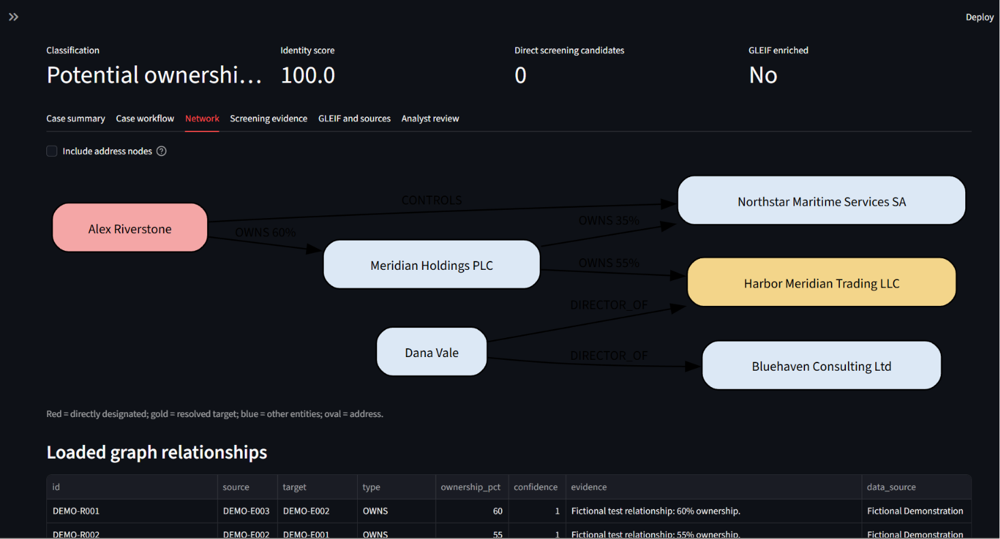
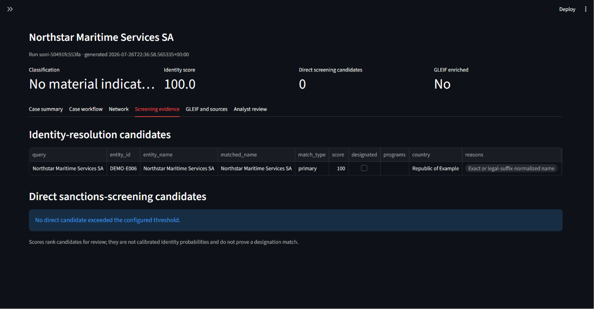
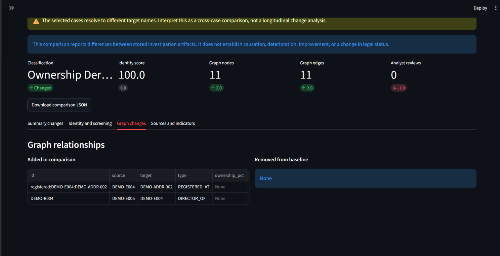
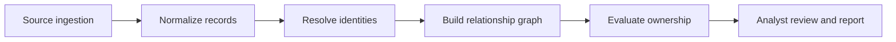

# Sanctions Ownership Network Investigator

A source-backed investigation MVP for sanctions screening, entity resolution,
ownership analysis, and relationship exploration.

The project answers a practical question:

> Does a company or person match a directly designated record, or does the
> available ownership graph indicate an indirect sanctions concern?

It combines an immediately runnable standard-library Python pipeline with
optional Streamlit, PostgreSQL, Neo4j, Docker, and PDF-reporting layers.

**Project status:** public portfolio release, version 1.0.0. The application is
an analyst decision-support demonstration, not production-ready compliance
software, legal advice, or a final legal determination.

## Evaluator quick start

Run the deterministic fictional case with Python 3.11 or newer:

```powershell
python main.py --mode sample --query "Harbor Meridian Trading LLC"
```

Expected result: `ownership_derived_candidate`. The command creates a
source-backed case directory without requiring a package installation or
network connection. See the [demonstration walkthrough](docs/DEMO_WALKTHROUGH.md)
for the dashboard, workflow, analyst-review, comparison, and export tour.

## What makes this different

Conventional list screening compares a name with a sanctions list. This project
separates four analytical questions:

1. **Identity:** Do records likely refer to the same entity?
2. **Designation:** Is the resolved entity directly designated?
3. **Ownership:** Does loaded direct or indirect ownership meet the configured
   aggregation threshold?
4. **Control and context:** Are there relationships that justify enhanced
   review without automatically establishing blocked status?

Every match and relationship retains its source, confidence, evidence, and
review status. The output is analyst support—not a final legal determination.

## Current MVP capabilities

- Bundled fictional demonstration network
- Download and parsing of OFAC's four relational SDN CSV files
- Targeted GLEIF legal-entity search by name or exact LEI
- Ranked GLEIF candidate selection with spacing-aware name comparison
- GLEIF Level 1 identity, address, registration, and legal-form enrichment
- GLEIF direct and ultimate accounting-consolidating parent graph links
- Primary-name and alias screening
- Legal-suffix normalization and token-aware fuzzy comparison
- SQLite investigative store requiring no database installation
- Iterative ownership propagation using a configurable 50% threshold
- Separation of direct designation, ownership-derived candidates, and control
- Shared-address investigative indicators
- Two- or three-hop graph extraction
- Neo4j-compatible node and relationship exports
- Markdown and optional PDF investigation briefs
- Streamlit entity, network, match-review, and evidence views
- Multi-case investigation registry with prior-run reopening
- Searchable case queue with status and priority filters
- Append-only workflow status, priority, assignment, tags, and update notes
- Consolidated case-queue export in CSV and JSON
- Side-by-side archived-case comparison with candidate and graph differences
- Backward-compatible `outputs/latest` snapshot for integrations
- Append-only analyst dispositions, notes, reviewer identity, and timestamps
- PostgreSQL schema and Docker Compose environment
- Standard-library automated tests and GitHub Actions

## Documentation

| Document | Purpose |
|---|---|
| [Architecture](docs/ARCHITECTURE.md) | Components, data flow, storage, and production gaps |
| [Methodology](docs/METHODOLOGY.md) | Matching, ownership, and analytical rules |
| [Model card](docs/MODEL_CARD.md) | Intended use, limitations, and human oversight |
| [Data dictionary](docs/DATA_DICTIONARY.md) | Records, fields, and relationships |
| [Analyst workflow](docs/ANALYST_WORKFLOW.md) | Review, queue, and audit-trail procedure |
| [GLEIF enrichment](docs/GLEIF_ENRICHMENT.md) | Identity and accounting-parent boundaries |
| [Demonstration walkthrough](docs/DEMO_WALKTHROUGH.md) | Reproducible reviewer tour and screenshot plan |
| [Portfolio brief](docs/PORTFOLIO_BRIEF.md) | Résumé bullets, project summary, and interview topics |
| [Version 1.0.0 release notes](docs/RELEASE_NOTES_v1.0.0.md) | Installation, highlights, and known limitations |
| [Release checklist](docs/RELEASE_CHECKLIST.md) | Validation and archive requirements |

## Dashboard preview

| Case investigation | Ownership network |
|---|---|
|  |  |
| **Screening evidence** | **Archived-case comparison** |
|  |  |

Additional views demonstrate the
[ownership finding](docs/images/02-ownership-finding.png) and
[recommended analyst actions and case artifacts](docs/images/05-analyst-actions.png).
All displayed entities and relationships are fictional.
## Demonstration finding

The bundled example is entirely fictional:

```text
Alex Riverstone (direct demonstration designation)
    └── owns 60% of Meridian Holdings PLC
            └── owns 55% of Harbor Meridian Trading LLC
```

The engine first marks Meridian Holdings as an ownership-derived candidate and
then propagates the finding to Harbor Meridian Trading. This tests multi-level
ownership logic while keeping direct name screening separate.

## Quick start

Python 3.11 or newer is recommended.

### 1. Run the zero-dependency demonstration

```powershell
python main.py --mode sample --query "Harbor Meridian Trading LLC"
```

No `pip install` is required for the command-line demonstration.

Each run is preserved under `outputs/cases/<run_id>/`:

- `investigation_result.json`
- `investigation_brief.md`
- `investigation_brief.pdf` when ReportLab is installed
- `investigation_graph.json`
- `investigator.sqlite`
- `neo4j/nodes.csv`
- `neo4j/relationships.csv`

The CLI also refreshes `outputs/latest/` as a compatibility snapshot for Docker,
Neo4j imports, and earlier integrations. Before publishing a new latest
snapshot, the application automatically archives an unregistered legacy latest
case so its artifacts and analyst-review database are retained.

### 2. Run the analyst dashboard

```powershell
python -m venv .venv
.\.venv\Scripts\Activate.ps1
python -m pip install --upgrade pip
pip install -e ".[dashboard,pdf]"
streamlit run app.py
```

The dashboard opens the case-investigation registry by default. Its workspaces
support:

- Selection and reopening of prior investigation runs
- Queue filtering by case text, workflow status, and priority
- Local assignment, tagging, and append-only workflow-event history
- Consolidated CSV and JSON queue exports
- Baseline-versus-comparison review of prior investigation artifacts
- Review of the generated executive finding and resolved entity
- Live graph exploration with optional address nodes
- Separate identity-resolution and sanctions-screening evidence
- GLEIF enrichment and source-register review
- Download of the JSON, graph, Markdown, and PDF case artifacts
- Append-only analyst dispositions and review history

Run `main.py` again to add another archived case and refresh the compatibility
snapshot. Analyst reviews are stored in each case's `investigator.sqlite` and
remain attached to that run while staying separate from the system-generated
classification.

### 3. Download and screen the current OFAC SDN files

```powershell
python main.py --mode live --query "ENTITY NAME"
```

The downloader sends a User-Agent header as required by OFAC's Sanctions List
Service. It retrieves:

- `SDN.CSV`
- `ALT.CSV`
- `ADD.CSV`
- `SDN_COMMENTS.CSV`

OFAC explains that all four files are needed to reconstruct the one-to-many
relationships among primary records, aliases, addresses, and long remarks.

To rerun against already downloaded files:

```powershell
python main.py --mode live --skip-download --query "ENTITY NAME"
```

### 4. Add GLEIF identity and accounting-parent enrichment

```powershell
python main.py --mode live --gleif-enrich --query "JPMorgan Chase & Co."
```

Narrow a name search with a two-letter country code:

```powershell
python main.py --mode live --gleif-enrich --country US --query "ENTITY NAME"
```

Use an exact LEI when the correct record is already known:

```powershell
python main.py --mode live --gleif-enrich --gleif-lei "LEI_HERE" --query "ENTITY NAME"
```

The selected GLEIF record and its published parent links are merged into the
same SQLite store, graph JSON, Neo4j CSV, Markdown brief, and PDF brief used by
the OFAC investigation. The dashboard also includes a separate GLEIF lookup
workspace for ranked candidate selection and parent-network review. Candidate
scores support disambiguation but are not identity probabilities; analysts
should confirm the LEI using jurisdiction, identifiers, registration status,
and address.

GLEIF Level 2 data identifies direct and ultimate **accounting consolidating
parents**. It does not provide a percentage ownership value. The application
therefore stores these links as contextual graph evidence and deliberately
excludes them from OFAC 50 Percent Rule propagation.

## Docker environment

Copy `.env.example` to `.env`, replace the demonstration passwords, and run:

```powershell
docker compose up --build
```

Services:

| Service | Address | Purpose |
|---|---|---|
| Streamlit | `http://localhost:8501` | Analyst interface |
| PostgreSQL | `localhost:5432` | Relational staging and case data |
| Neo4j Browser | `http://localhost:7474` | Graph exploration |
| Neo4j Bolt | `bolt://localhost:7687` | Application connectivity |

The command-line MVP writes to SQLite by default. The included PostgreSQL schema
and Neo4j exports are the migration foundation for the next phase.

## Analytical workflow



## Analyst review and audit trail

The latest-investigation workspace records one of five human dispositions:

- Needs more information
- Identity confirmed
- Identity rejected
- Escalated for compliance review
- Closed - no material indicator

Each entry stores the run ID, target identity, original system classification,
reviewer, required notes, and timestamp. Entries are append-only: recording a
review creates a new audit event and never overwrites the model output or an
earlier analyst decision.

## Case workflow

Each case begins in the derived default state **Open / Normal / Unassigned**.
Analysts can record controlled status and priority values, a local assignee,
comma-separated tags, the person making the update, and required reasoning.

Workflow changes are append-only events. The newest event supplies the current
queue state without deleting the earlier assignment or status history. Workflow
state manages work routing only; it does not change the sanctions
classification or analyst disposition.

## Case comparison and queue export

The **Case comparison** workspace compares two archived runs and reports:

- Classification and target changes
- Identity-score and candidate-count deltas
- Added or removed identity and sanctions-screening candidates
- Added or removed graph relationships
- Source and investigative-indicator differences
- Workflow-state and analyst-review activity

Comparison JSON can be downloaded for reproducibility. The result describes
differences between stored artifacts; it does not establish causation,
deterioration, improvement, or a change in legal status.

The **Queue exports** control in the case-investigation sidebar downloads all
case summaries as CSV or JSON, including status, priority, assignee, tags,
workflow timestamps, event counts, and analyst-review counts.

## Matching methodology

The name matcher uses:

- Unicode normalization
- Punctuation and whitespace normalization
- Optional legal-suffix removal
- Direct character-sequence comparison
- Token-sorted comparison
- Token overlap
- Optional country and exact-identifier context

An exact identifier supersedes a fuzzy name comparison. A name score alone
never automatically merges two records.

Scores are ranking aids rather than calibrated probabilities. Production
thresholds should be evaluated on labeled entity pairs that resemble the
organization's customers, languages, and jurisdictions.

## Ownership methodology

The engine begins with directly designated entities. For each unclassified
entity, it aggregates the loaded percentages held by entities already marked
directly designated or ownership-derived. An entity crossing the configured
threshold is added to the next propagation round.

This graph operation can identify a chain such as:

```text
blocked owner -> majority-owned holding company -> majority-owned subsidiary
```

The classification is deliberately called an
`ownership_derived_candidate`. Analysts must validate:

- Ownership percentages
- Direct versus indirect ownership
- Aggregate holdings
- Effective dates
- Divestments
- Program-specific restrictions
- Licenses and authorizations
- Current official guidance

Control relationships are stored and reported separately because control alone
is not identical to ownership under OFAC's 50 Percent Rule.

## Data sources

- [OFAC SDN List](https://ofac.treasury.gov/specially-designated-nationals-and-blocked-persons-list-sdn-human-readable-lists)
- [OFAC relational flat-file tutorial](https://ofac.treasury.gov/sdn-list-data-formats-data-schemas/tutorial-on-the-use-of-list-related-legacy-flat-files)
- [OFAC 50 Percent Rule FAQs](https://ofac.treasury.gov/faqs/topic/1521)
- [GLEIF API](https://www.gleif.org/en/lei-data/gleif-api) — implemented targeted identity and accounting-parent enrichment
- [GLEIF Level 2 data](https://www.gleif.org/en/lei-data/access-and-use-lei-data/level-2-data-who-owns-whom)
- [SEC EDGAR APIs](https://www.sec.gov/search-filings/edgar-application-programming-interfaces) — planned filing enrichment
- [ICIJ Offshore Leaks download](https://offshoreleaks.icij.org/pages/database) — planned investigative enrichment

The current release implements OFAC ingestion and targeted GLEIF enrichment.
The other sources are documented for controlled later phases.

## Repository structure

```text
sanctions-ownership-network-investigator/
├── .github/
├── app.py
├── main.py
├── CHANGELOG.md
├── CONTRIBUTING.md
├── SECURITY.md
├── CITATION.cff
├── data/
│   ├── raw/ofac/
│   └── sample/
├── docs/
├── scripts/
├── sql/
├── src/sowni/
├── tests/
├── Dockerfile
├── docker-compose.yml
└── pyproject.toml
```

## Validation

Run:

```powershell
python -m unittest discover -s tests -v
python scripts\check_publication.py
```

The suite checks normalization, alias screening, ownership propagation, OFAC
relational-file parsing, GLEIF identity/parent parsing, dashboard artifact
loading and graph rendering, legacy-case migration, multi-case indexing,
append-only analyst reviews and workflow events, controlled workflow values,
queue exports, deterministic case-comparison deltas, the exclusion of GLEIF
accounting-parent links from percentage ownership, and the complete
demonstration pipeline. The publication audit checks required public files,
version synchronization, documentation links, release notes, and disclosure
boundaries.

## Build a clean release

Use the standard-library release builder instead of compressing the working
folder manually:

```powershell
python scripts\build_release.py
```

The builder creates `sanctions-ownership-network-investigator-mvp.zip` in the
parent directory. It validates the archive and excludes:

- `.venv`, `.venv-1`, `venv`, and other numbered virtual environments
- Python caches and test/linter caches
- `*.egg-info`, build, and distribution metadata
- `.env`, SQLite databases, and existing ZIP files
- Downloaded OFAC files
- Generated reports, graphs, PDFs, and case outputs
- Temporary PDF-rendering files

The archive retains `.gitkeep` placeholders so the expected raw-data and output
directories are recreated after extraction. Run
`python scripts\check_publication.py` and see
[`docs/RELEASE_CHECKLIST.md`](docs/RELEASE_CHECKLIST.md) before publication.

## Roadmap

- GLEIF reporting-exception detail
- PostgreSQL repository adapter
- Neo4j driver integration
- Identifier-aware entity resolution
- Time-aware ownership and divestment analysis
- Aggregate blocked ownership across multiple owners
- SEC subsidiary and ownership filing extraction
- ICIJ reconciliation and controlled enrichment
- Authentication, role-based access, and supervisory approval
- Backtesting on labeled match and non-match pairs

## Responsible use

This project is for lawful compliance research, due diligence, education, and
analyst decision support. It does not establish that a person or organization
has committed misconduct. A list match, shared address, offshore-dataset
appearance, or network connection must be reviewed in context.

Always consult current official sources and qualified compliance or legal
personnel before acting on a result.

## License

MIT. See [LICENSE](LICENSE).
