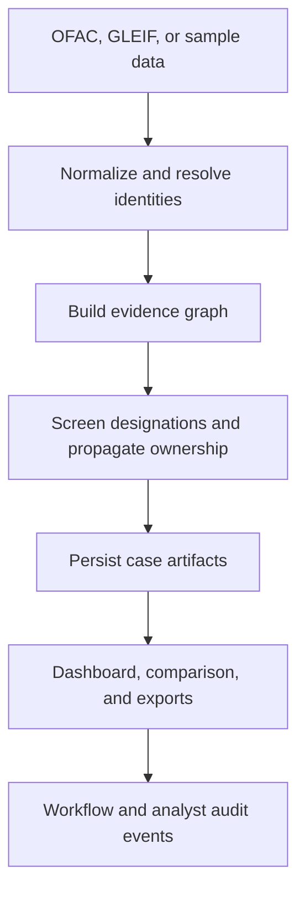

# Architecture

## Design goal

The application makes an investigation reproducible from source records through
system classification, workflow activity, and analyst disposition. It keeps
identity evidence, sanctions evidence, ownership logic, and human decisions
separate so each can be inspected independently.

## Component flow



## Runtime layers

| Layer | Primary modules | Responsibility |
|---|---|---|
| Entry points | `main.py`, `app.py` | CLI orchestration and Streamlit launch |
| Sources | `ofac.py`, `gleif.py`, `sample_data.py` | Retrieve and parse source records |
| Resolution | `normalize.py`, `matching.py` | Normalize names and rank candidate identities |
| Analysis | `ownership.py`, `graph.py`, `pipeline.py` | Screen records, propagate ownership candidates, build networks |
| Persistence | `database.py`, `cases.py` | Store evidence, case artifacts, reviews, and workflow events |
| Review | `dashboard.py`, `comparison.py` | Explore evidence, manage local workflow, compare archived cases |
| Reporting | `report.py` | Generate Markdown, PDF, JSON, and Neo4j-compatible outputs |
| Distribution | `release.py`, `publication.py` | Build and audit a portable public release |

## Case storage

Each run is immutable at the artifact level and receives its own directory:

```text
outputs/
├── cases/
│   ├── index.json
│   └── <run_id>/
│       ├── investigation_result.json
│       ├── investigation_graph.json
│       ├── investigation_brief.md
│       ├── investigation_brief.pdf
│       ├── investigator.sqlite
│       └── neo4j/
└── latest/
```

`outputs/latest` is a compatibility snapshot. The case registry is the source
for historical runs. Analyst reviews and workflow events are append-only rows
inside the case-specific SQLite database; they do not overwrite the original
system classification.

## Analytical boundaries

- OFAC data supports designation screening; it does not provide a complete
  corporate ownership graph.
- GLEIF parent links describe accounting consolidation, not percentage
  ownership, beneficial ownership, or sanctions status.
- Fuzzy matching scores rank candidates; they are not calibrated probabilities.
- Ownership propagation uses only loaded percentage-ownership edges.
- Comparisons describe differences between stored artifacts; they do not infer
  causation or a change in legal status.

## Production gaps

Before production use, the architecture would require authentication,
role-based access, encrypted and centralized persistence, concurrency control,
source freshness monitoring, calibrated matching thresholds, jurisdiction and
program-specific policy rules, supervisory approval, observability, backup and
recovery, and an independent security and model-risk review.
